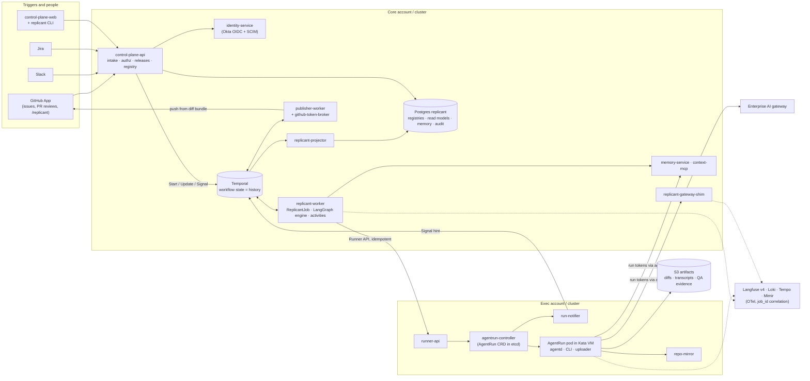
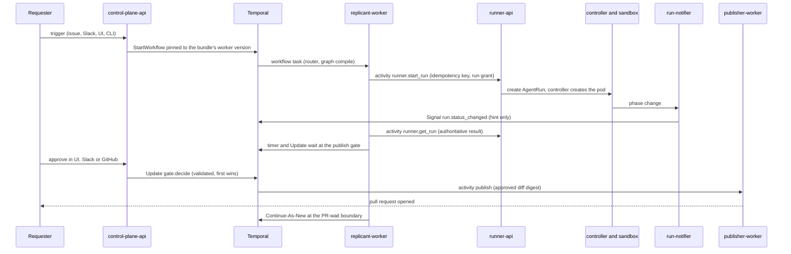

# Replicant: Specification

Replicant is an enterprise software factory: it turns issues, commands and schedules into reviewed pull requests.

**Status:** closed on 2026-10-24 under the user's instruction "blockers only from here; log everything else as known
issues and finish". All known blockers are fixed ([known-issues.md](90-reviews/known-issues.md) §1). Contracts are
frozen at the versions in [FROZEN.md](00-contracts/FROZEN.md). Constraints D-01..D-26 are in
`prompts/software-factory/01-shared-context.md`, as amended by the accepted challenges below.

This is the entry point. It gives a reading order, a one-page architecture summary, links to every section,
contract and ADR, the accepted challenges to decided constraints, the open questions that need a human, and the
remaining unverified claims with their fallbacks.

## Reading order

| If you are | Read, in order |
|---|---|
| Everyone (one hour) | this page → [architecture.md](00-contracts/architecture.md) → [state-ownership.md](00-contracts/state-ownership.md) → [plan.md](99-implementation-plan/plan.md) §1 (v0) → [known-issues.md](90-reviews/known-issues.md) |
| Implementing anything | the contracts in [00-contracts/](00-contracts/README.md) for your interfaces → your section's README → [plan.md](99-implementation-plan/plan.md) §5 (your tasks) → [repo-layout.md](11-local-dev/repo-layout.md) → [test-strategy.md](11-local-dev/test-strategy.md) |
| Orchestration and versioning | [01-orchestration](01-orchestration/README.md) → [06-releases-and-evals](06-releases-and-evals/README.md) → [events-and-signals.md](00-contracts/events-and-signals.md) |
| Execution and isolation | [runner-api.openapi.yaml](00-contracts/runner-api.openapi.yaml) and [agentrun-crd.md](00-contracts/agentrun-crd.md) → [02-execution](02-execution/README.md) → [03-agents-and-tools](03-agents-and-tools/README.md) → [09-security](09-security/README.md) |
| Memory and context | [04-memory-and-context](04-memory-and-context/README.md) → [curation-ui.md](04-memory-and-context/curation-ui.md) → [07 ui/memory.md](07-control-plane-and-ux/ui/memory.md) |
| UX and approvals | [07-control-plane-and-ux](07-control-plane-and-ux/README.md) → [design/direction.md](07-control-plane-and-ux/design/direction.md) → [approvals.md](07-control-plane-and-ux/approvals.md) → [05-qa artifacts.md](05-qa/artifacts.md) |
| Security review | [threat-model.md](09-security/threat-model.md) → [agent-capabilities.md](09-security/agent-capabilities.md) → [control-review.md](09-security/control-review.md) → [R2-red-team.md](90-reviews/R2-red-team.md) |
| Platform and operations | [10-data-platform](10-data-platform/README.md) → [08-observability](08-observability/README.md) → [11-local-dev](11-local-dev/README.md) |
| Deciding open questions | [open-questions-summary.md](_coordination/open-questions-summary.md) §2 |

## Architecture on one page

Replicant turns a trigger (GitHub, Jira, Slack, UI, CLI, schedule) into one `JobRequest`, runs a Temporal
workflow per job, executes every agent step as a native coding CLI inside an isolated AgentRun, validates the change
in the sandbox, routes it through human approval and publishes a PR. It then stays with the PR through review and
repair, and learns from reviewers through a curated memory subsystem.

**The ideas that carry the design**

| Idea | What it means | Where |
|---|---|---|
| Four stores, one owner each | Workflow state lives only in Temporal history. Cluster resource state lives in the AgentRun CRD. Artifact bodies live in S3. Replicant domain data lives in Postgres. The UI reads one Postgres projection | [state-ownership.md](00-contracts/state-ownership.md), [ADR-004](00-contracts/adr/004-ui-read-model-projection.md) |
| Narrow execution boundary | Activities call the Runner API with an idempotency key and never touch Kubernetes. Completion is a Signal hint plus timer polling | [runner-api.openapi.yaml](00-contracts/runner-api.openapi.yaml), [ADR-002](00-contracts/adr/002-runner-completion-callback-vs-poll.md), [ADR-008](00-contracts/adr/008-deterministic-run-identity.md) |
| Graphs are configuration | LangGraph `StateGraph`s are compiled per job inside the workflow from the bundle's GraphDefinition. Every unit of real work is an explicit-ID activity. An interpreter engine is the fallback | [ADR-01-001](01-orchestration/adr/001-challenge-d01-langgraph-runs-in-workflow-not-plugin-activity-nodes.md), [ADR-01-008](01-orchestration/adr/008-graph-definitions-are-configuration-compiled-per-job.md) |
| Release Bundles pin behaviour | Every job is pinned at start to a content-addressed bundle (graph, worker build, agents, environments, prompts, CLI digests, models, policies, memory policy). Ramps are bundle assignments, and rollback is one transaction | [ADR-005](00-contracts/adr/005-release-bundle-unit-of-versioning.md), [ADR-006](00-contracts/adr/006-bundle-assignment-drives-version-pinning.md), [promotion.md](06-releases-and-evals/promotion.md) |
| Capability-based containment | Assume a fully prompt-injected agent with a shell. Credentials exist only in `replicant-agentd`, with per-audience run tokens bounded by core-signed run grants. Egress is default-deny FQDN. The sandbox has no push credential, and the Publisher pushes only the approved diff digest | [threat-model.md](09-security/threat-model.md), [ADR-09-005](09-security/adr/005-run-grants-bound-exec-side-minting.md), [ADR-03-001](03-agents-and-tools/adr/001-entrypoint-and-agentd-credential-isolation.md) |
| Separate execution account | Sandboxes run in their own EKS cluster in a separate AWS account with no internet route | [ADR-007](00-contracts/adr/007-separate-execution-cluster.md), [ADR-09-001](09-security/adr/001-confirm-adr-007-exec-cluster-separate-account.md) |
| Evidence-chosen runtime | Kata Containers + Cloud Hypervisor is the recommended default, gVisor is the standby, and the benchmark gates can flip any workload class | [runtime-evaluation.md](02-execution/runtime-evaluation.md), [ADR-02-001](02-execution/adr/02-001-default-runtime-per-workload-class.md) |
| Deterministic gates | Gate presence comes from deterministic risk rules, and an LLM may only raise risk. Every channel resolves to one Temporal Update, and the first valid decision wins | [gates.md](01-orchestration/gates.md), [approvals.md](07-control-plane-and-ux/approvals.md) |
| Memory as a governed subsystem | Scoped, provenance-tracked, lifecycle-managed, pinned per job, evaluated with holdouts, and curated by admins only (D-25) | [04-memory-and-context](04-memory-and-context/README.md) |
| Local-first | One command runs the whole stack, and a `kind` profile runs the real controller | [stack.md](11-local-dev/stack.md), [walkthroughs.md](11-local-dev/walkthroughs.md) |

**One job, end to end** (Temporal primitives named at each step):

## Sections

| # | Section | Owner | Scope |
|---|---|---|---|
| 00 | [Architecture and contracts](00-contracts/README.md) | WS-00 | Boundaries, state ownership, identifiers, Runner API, CRD, messages, JobRequest, definitions and bundles, artifact layout, Postgres ownership |
| 01 | [Orchestration, graphs, versioning](01-orchestration/README.md) | WS-01 | Temporal + LangGraph, graph shapes, router, gates, Worker Versioning, history budget |
| 02 | [Execution, isolation, workspace storage](02-execution/README.md) | WS-02 | runner-api, controller, runtimes and benchmark gates, workspace limits, network, fast path, local runner |
| 03 | [Agents, tools, gateway](03-agents-and-tools/README.md) | WS-03 | CLI invocation, agent and environment definitions, config publishing, gateway shim and budgets |
| 04 | [Memory and context](04-memory-and-context/README.md) | WS-04 | Long-term and working memory, retrieval and injection, safety, curation, ecosystem context |
| 05 | [QA/QE stage](05-qa/README.md) | WS-05 | Builds, services, health, headless Playwright, flake classification, approver evidence |
| 06 | [Releases and evals](06-releases-and-evals/README.md) | WS-06 | Release Bundles, eval harness, promotion pipeline, online metrics, upgrades, self-improvement |
| 07 | [Control plane and UX](07-control-plane-and-ux/README.md) | WS-07 | UI and API, identity, approvals, GitHub App, triggers, notifications, design system |
| 08 | [Observability](08-observability/README.md) | WS-08 | Telemetry model, session capture and redaction, dashboards and SLOs, audit |
| 09 | [Security and tenancy](09-security/README.md) | WS-09 | Threat model, capabilities, secrets and keys, tenancy, data handling, policies |
| 10 | [Data platform](10-data-platform/README.md) | WS-10 | Postgres, schema management, Temporal persistence, object storage, recovery, lifecycle, cost |
| 11 | [Local dev and test](11-local-dev/README.md) | WS-11 | Local stack, parity, walkthroughs, test strategy, repo layout and CI |
| 90 | Reviews | R1, R2, orchestrator | [triage.md](90-reviews/triage.md), [R1-consistency.md](90-reviews/R1-consistency.md), [R1-verification.md](90-reviews/R1-verification.md), [R2-red-team.md](90-reviews/R2-red-team.md), [known-issues.md](90-reviews/known-issues.md) |
| 99 | Implementation plan | Z | [plan.md](99-implementation-plan/plan.md), [traceability.md](99-implementation-plan/traceability.md) |
| — | Coordination | all | [open-questions.md](_coordination/open-questions.md), [open-questions-summary.md](_coordination/open-questions-summary.md), [contract-change-requests.md](_coordination/contract-change-requests.md), [cross-ws-dependencies.md](_coordination/cross-ws-dependencies.md), [verification-log.md](_coordination/verification-log.md) |

## Contracts

| ID | Version | Files |
|---|---|---|
| C-ARCH | 1.5.4 | [architecture.md](00-contracts/architecture.md) |
| C-STATE | 1.10.2 | [state-ownership.md](00-contracts/state-ownership.md) |
| C-IDS | 1.13.4 | [ids-and-naming.md](00-contracts/ids-and-naming.md) |
| C-RUNNER | 2.5.3 | [runner-api.openapi.yaml](00-contracts/runner-api.openapi.yaml), [run-result.schema.json](00-contracts/schemas/run-result.schema.json) |
| C-CRD | 2.4.0 | [agentrun-crd.yaml](00-contracts/agentrun-crd.yaml), [agentrun-crd.md](00-contracts/agentrun-crd.md) |
| C-MSG | 1.7.4 | [events-and-signals.md](00-contracts/events-and-signals.md), [workflow-messages.schema.json](00-contracts/schemas/workflow-messages.schema.json) |
| C-JOBREQ | 1.4.2 | [job-request.schema.json](00-contracts/job-request.schema.json) |
| C-DEF | 2.5.0 | [definitions-contracts.md](00-contracts/definitions-contracts.md), [definition-envelope.schema.json](00-contracts/schemas/definition-envelope.schema.json), [release-bundle.schema.json](00-contracts/schemas/release-bundle.schema.json) |
| C-ART | 1.10.4 | [artifact-layout.md](00-contracts/artifact-layout.md), [run-manifest.schema.json](00-contracts/schemas/run-manifest.schema.json) |
| C-PG | 1.4.3 | [postgres-ownership.md](00-contracts/postgres-ownership.md) |

Freeze record and adjudications: [FROZEN.md](00-contracts/FROZEN.md). Change process:
[contract-change-requests.md](_coordination/contract-change-requests.md).

## Accepted challenges to decided constraints

| Constraint | What changed | ADR | Accepted by |
|---|---|---|---|
| D-01 | LangGraph runs inside the workflow, compiled per job; the `temporalio-langgraph` plugin is not a runtime dependency; an interpreter engine is the fallback | [ADR-01-001](01-orchestration/adr/001-challenge-d01-langgraph-runs-in-workflow-not-plugin-activity-nodes.md) | Orchestrator (FROZEN.md) |
| D-07 | FS quota monitoring does not enforce. Each runtime class gets an enforcing hard limit plus the watchdog | [ADR-014](00-contracts/adr/014-challenge-d07-fsquota-monitoring-is-not-enforcement.md) | Orchestrator; D-07 text amended |
| D-08 | Local S3 is SeaweedFS, because the MinIO repository is archived; MinIO from source is a profile | [ADR-11-004](11-local-dev/adr/004-challenge-d08-minio-locally.md), [ADR-WS10-007](10-data-platform/adr/007-challenge-d08-minio-community-archived.md) | Orchestrator (CCR-11-02); D-08 text amended |
| D-12 | Under Kata, memory requests follow the host-side footprint and equal the limit when the p50 ratio is ≥ 0.8 | [ADR-03-008](03-agents-and-tools/adr/008-challenge-d12-kata-memory-requests.md) | Orchestrator; D-12 text amended |
| D-26 | Services check that the schema is compatible with the revision range they support, not strictly equal | CCR-10-01 ([schema-management.md](10-data-platform/schema-management.md)) | Orchestrator; D-26 text amended |

## Open questions needing a human

The full deduplicated list, with a recommendation for each, is in
[open-questions-summary.md](_coordination/open-questions-summary.md) (35 need a human, 14 are engineering, 29 are
decided). The ten that matter most:

| ID | Question | Recommendation | Who decides |
|---|---|---|---|
| OQ-00-09 / OQ-03-01 | Does the enterprise AI gateway support per-run credentials, budgets and usage export? | Keep the replicant-owned shim in front unless GW-1..17 are native | Gateway platform owner |
| OQ-01-06 | Hard job lifetime | 60 days | Product (the user) |
| OQ-ORCH-01 | Fork-based publishing to keep agent code out of target CI before review | Same-repo branches with the `critical` CI-path gate and onboarding CI exclusion in v1; forks per tenant later | The user |
| OQ-01-04 / OQ-05-01 | QA still failing after the fix budget | `fail_job` by default; draft-PR gate as a tenant opt-in | Product |
| OQ-04-01 | Auto-activate repo/path memory rules with probation | Yes, only from P8 and only if memory evals show benefit | Product |
| OQ-06-05 | Annual eval budget | Fund the $1.2M/year ceiling for two quarters, then re-decide | Engineering leadership |
| OQ-09-01 | Which tenants are `restricted` | Payments core, identity, security tooling | Security leadership |
| OQ-10-01 | Regional DR RTO | 4 h | Product |
| OQ-06-04 | Tenant consent for the shared golden set | Per-tenant opt-in with erasure on withdrawal | Product, legal |
| OQ-07-05 | GitHub identity linkage source | GHEC SAML external identities, OAuth link otherwise | Enterprise GitHub owners |

## Unverified claims and their fallbacks

About 70 claims are tagged `[unverified]` inline and in [verification-log.md](_coordination/verification-log.md).
The load-bearing ones are gated by benchmarks or spikes in [plan.md](99-implementation-plan/plan.md) §2–§3:

| Claim | Gate | Fallback |
|---|---|---|
| Kata 4.3.1 runtime-rs + Cloud Hypervisor on nested-virt `m8id` meets build performance and density | B-NPM-01, B-GO-01, B-CARGO-01, B-DENS-01 (S-1) | `m8id.metal-48xl` pool weight, then gVisor for coding classes |
| `guestBlockDevice` (NRI + Kata direct volume) enforces the workspace limit before eviction | B-DISK-01..04 (S-1) | `xfsProjectQuota` on virtio-fs at residual 12 with conditions, or `fixedSizeVolume` |
| Service ClusterIP reachability from Kata under Cilium | B-NET-01 probe 38 | repo-mirror and the OTLP collector behind internal NLBs with `toFQDNs` |
| Sandbox stdout reaches `/var/log/pods` under Kata and gVisor | B-LOG-01 | OTLP log transport per RuntimeClass |
| Rootless BuildKit in the Kata guest with the WS-05 privileges | B-BUILD-01, B-BUILD-03 | QA without image builds; CI builds images |
| LangGraph in-workflow determinism; `temporalio-langgraph` in public preview | S-2, nightly replay | interpreter engine (ADR-01-001) |
| Worker Deployment RPCs (Experimental in the protos) | S-2, contract tests | release operations isolated in control-plane-api |
| Enterprise gateway lacks per-run tokens and budgets | S-4 | Replicant gateway shim |
| Temporal on Aurora PostgreSQL 16 (outside Temporal's tested matrix) | S-5 soak | RDS for PostgreSQL 16 |
| SeaweedFS conditional writes and STS session policies | S-6 | per-run identities; nightly real-S3 contract job |
| CEL admission policies, Kyverno, Temporal Authorizer never run on real servers | S-7 | — (must pass before P1 exit) |
| Langfuse v4 OTel ingestion storage pattern and startup migrations | S-8 | pre-upgrade migration Job; cost range in platform.md §4.2 |
| Kata inside kind nodes | S-9 | `isolation.degraded` runc classes locally; `k8s-kata` CI job on KVM runners |

The full list, with accepted risks, is in [known-issues.md](90-reviews/known-issues.md) §4–§5.

## Every section document

Section READMEs are linked above. Every other document, by section:

- **00 Architecture and contracts:** [AgentRun CRD: Semantics and Lifecycle](00-contracts/agentrun-crd.md) · [Reference Architecture](00-contracts/architecture.md) · [Object Storage Contract (Artifact Layout)](00-contracts/artifact-layout.md) · [Registry Object Contracts and Release Bundles](00-contracts/definitions-contracts.md) · [Workflow Message Catalog (Signals, Updates, Queries)](00-contracts/events-and-signals.md) · [Contracts Frozen](00-contracts/FROZEN.md) · [Identifiers, Naming, and Correlation](00-contracts/ids-and-naming.md) · [Postgres Ownership Map](00-contracts/postgres-ownership.md) · [State Ownership Matrix](00-contracts/state-ownership.md)
- **01 Orchestration:** [Extensibility: Node Registry, Graphs as Configuration, Modifiers](01-orchestration/extensibility.md) · [Human Gates](01-orchestration/gates.md) · [Shape 1: Bugfix](01-orchestration/graphs/bugfix.md) · [Shape 2: Feature and API change](01-orchestration/graphs/feature-and-api-change.md) · [Shape 4: Hotfix and docs / low-risk (gate variants)](01-orchestration/graphs/hotfix-and-docs.md) · [Shape 5: Scheduled maintenance (fan-out)](01-orchestration/graphs/maintenance-fanout.md) · [Shape 3: PR-comment repair](01-orchestration/graphs/pr-repair.md) · [Graph Shapes: Common Building Blocks](01-orchestration/graphs/README.md) · [History Budget (must-answer)](01-orchestration/history-budget.md) · [WS-01 Reference Implementation](01-orchestration/reference/README.md) · [Router: JobRequest → workflow type and graph](01-orchestration/router.md) · [Temporal and LangGraph Integration](01-orchestration/temporal-langgraph.md) · [Temporal Platform](01-orchestration/temporal-platform.md) · [Workflow Versioning](01-orchestration/versioning.md)
- **02 Execution:** [Runtime Benchmark Harness (`sbxbench`)](02-execution/benchmark/README.md) · [AgentRun Controller](02-execution/controller.md) · [Fast Path: Keeping Sandbox-Ready Time Under the p95 Target](02-execution/fast-path.md) · [Run Lifecycle, Failure Paths, and Must-Answers](02-execution/lifecycle-and-failures.md) · [Local Implementations of the Execution Contract](02-execution/local-runner.md) · [Sandbox Network Controls](02-execution/network.md) · [Runner Service (runner-api) and run-notifier](02-execution/runner-service.md) · [Isolation Runtime Evaluation and Recommendation](02-execution/runtime-evaluation.md) · [Workspace Storage](02-execution/workspace-storage.md)
- **03 Agents and tools:** [Agent Definition (`AgentDefinition` kind)](03-agents-and-tools/agent-definition.md) · [CLI Invocation and the Sandbox Runner Entrypoint](03-agents-and-tools/cli-invocation.md) · [Config Repository and Registry Publishing](03-agents-and-tools/config-publishing.md) · [Environment Definition, Resource Profiles, and Image Strategy](03-agents-and-tools/environment-definition.md) · [AI Gateway Integration](03-agents-and-tools/gateway.md)
- **04 Memory and context:** [Context Budgeting](04-memory-and-context/context-budget.md) · [Curation UI Requirements](04-memory-and-context/curation-ui.md) · [Data Model: schemas `memory` and `ecosystem`](04-memory-and-context/data-model.md) · [Ecosystem Context and Briefings](04-memory-and-context/ecosystem-context.md) · [Evaluating Memory](04-memory-and-context/memory-evals.md) · [PR Reply Behavior](04-memory-and-context/pr-replies.md) · [Retrieval, Injection, and Snapshot Pinning](04-memory-and-context/retrieval-injection.md) · [Memory Poisoning and Safety](04-memory-and-context/safety.md) · [Scoping, Inheritance, and Precedence](04-memory-and-context/scoping.md) · [Memory Taxonomy](04-memory-and-context/taxonomy.md) · [Job Working Memory and CLI Session Continuity](04-memory-and-context/working-memory.md) · [Write Path: from PR Feedback to Active Memory](04-memory-and-context/write-path.md)
- **05 QA/QE:** [QA Artifacts and How Reviewers See Them](05-qa/artifacts.md) · [Per-Codebase QA Configuration](05-qa/configuration.md) · [Dependencies of the App Under Test](05-qa/dependencies.md) · [Failure Feedback: QA Result Schema, Classification, Routing, Flakes](05-qa/failure-feedback.md) · [Headless Web Validation](05-qa/headless-validation.md) · [Health Criteria](05-qa/health.md) · [Runtime Assumptions: QA under Kata, and What Changes under gVisor](05-qa/runtime-assumptions.md) · [QA/QE Stage Orchestration](05-qa/stage-design.md)
- **06 Releases and evals:** [Evaluation Harness](06-releases-and-evals/eval-harness.md) · [Online Metrics](06-releases-and-evals/online-metrics.md) · [Promotion Pipeline](06-releases-and-evals/promotion.md) · [Release Bundles: Schema, Resolution, Diff, Assignment](06-releases-and-evals/release-bundle.md) · [Self-Improvement Loop](06-releases-and-evals/self-improvement.md) · [CLI and Model Upgrades](06-releases-and-evals/upgrades.md)
- **07 Control plane and UX:** [Approvals](07-control-plane-and-ux/approvals.md) · [Control-plane architecture](07-control-plane-and-ux/architecture.md) · [WS-07 data model (Replicant Postgres)](07-control-plane-and-ux/data/README.md) · [Component inventory](07-control-plane-and-ux/design/components.md) · [Contrast and colour-vision report](07-control-plane-and-ux/design/contrast-report.md) · [Self-critique log](07-control-plane-and-ux/design/critique.md) · [Design direction: "drafting table"](07-control-plane-and-ux/design/direction.md) · [GitHub App, webhook ingestion, token broker, and Publisher](07-control-plane-and-ux/github-app.md) · [Identity and authorization](07-control-plane-and-ux/identity.md) · [Notifications](07-control-plane-and-ux/notifications.md) · [Tenant onboarding checklist](07-control-plane-and-ux/onboarding.md) · [Triggers and the CLI](07-control-plane-and-ux/triggers.md) · [Admin and tenant settings](07-control-plane-and-ux/ui/admin.md) · [Approval inbox](07-control-plane-and-ux/ui/approval-inbox.md) · [Cost and quotas](07-control-plane-and-ux/ui/cost-quotas.md) · [Steer, pause, cancel, take over](07-control-plane-and-ux/ui/job-actions.md) · [Job detail](07-control-plane-and-ux/ui/job-detail.md) · [Job list](07-control-plane-and-ux/ui/job-list.md) · [Memory curation (replicant-admins only, D-25) and non-admin views](07-control-plane-and-ux/ui/memory.md) · [Information architecture and screens](07-control-plane-and-ux/ui/README.md) · [Registries](07-control-plane-and-ux/ui/registries.md) · [Releases and versions](07-control-plane-and-ux/ui/releases.md)
- **08 Observability:** [Audit Trail](08-observability/audit.md) · [Dashboards, Correlation, SLOs and Alerts](08-observability/dashboards.md) · [Observability Platform Deployment](08-observability/platform.md) · [Coding-Session Capture, Redaction, Leak Purge, and Langfuse Retention](08-observability/session-capture.md) · [Telemetry Model](08-observability/telemetry-model.md)
- **09 Security:** [Agent Capability Model](09-security/agent-capabilities.md) · [Control Review of Phase 2 Sections](09-security/control-review.md) · [Data Classification, Handling, and Compliance](09-security/data-handling.md) · [Secrets, Credentials, and Keys](09-security/secrets.md) · [Tenancy and Tenant Isolation](09-security/tenancy.md) · [Threat Model](09-security/threat-model.md)
- **10 Data platform:** [Capacity and Cost](10-data-platform/capacity-and-cost.md) · [Consolidated DDL Index: database `replicant`](10-data-platform/ddl/INDEX.md) · [Data Lifecycle: Retention and Deletion](10-data-platform/lifecycle.md) · [Object Storage](10-data-platform/object-storage.md) · [Postgres Topology and Operation](10-data-platform/postgres.md) · [Backup, Recovery, and Disaster Recovery](10-data-platform/recovery.md) · [Schema Management and Migrations](10-data-platform/schema-management.md) · [Temporal Persistence and Hosting](10-data-platform/temporal-persistence.md)
- **11 Local dev and test:** [Gateway Stub (local operation of `replicant-gateway-shim`)](11-local-dev/gateway-stub.md) · [Stub vs Production-Identical Inventory](11-local-dev/parity.md) · [Repository Layout, Build Tooling, and CI](11-local-dev/repo-layout.md) · [Local Stack](11-local-dev/stack.md) · [Test Strategy](11-local-dev/test-strategy.md) · [Walkthroughs](11-local-dev/walkthroughs.md)

## Architecture decision records

| Section | ADR | Title |
|---|---|---|
| 00 | [ADR-001](00-contracts/adr/001-gates-updates-vs-signals.md) | Temporal Updates vs Signals for human gates and job control |
| 00 | [ADR-002](00-contracts/adr/002-runner-completion-callback-vs-poll.md) | Runner completion via Signal hint plus timer polling (not a long-poll activity) |
| 00 | [ADR-003](00-contracts/adr/003-temporal-self-hosted-vs-cloud.md) | Temporal self-hosted on EKS vs Temporal Cloud (initial recommendation) |
| 00 | [ADR-004](00-contracts/adr/004-ui-read-model-projection.md) | UI read model as a Temporal → Postgres projection |
| 00 | [ADR-005](00-contracts/adr/005-release-bundle-unit-of-versioning.md) | The Release Bundle is the unit of versioning |
| 00 | [ADR-006](00-contracts/adr/006-bundle-assignment-drives-version-pinning.md) | Bundle assignment decides the pinned worker deployment version at start |
| 00 | [ADR-007](00-contracts/adr/007-separate-execution-cluster.md) | Separate EKS cluster for execution |
| 00 | [ADR-008](00-contracts/adr/008-deterministic-run-identity.md) | Deterministic run identity; idempotency on the AgentRun name |
| 00 | [ADR-009](00-contracts/adr/009-job-lifetime-spans-pr-review.md) | A job's lifetime spans PR review and repair |
| 00 | [ADR-010](00-contracts/adr/010-steering-via-runner-inbox.md) | Steering messages delivered through a Runner-managed per-run inbox |
| 00 | [ADR-011](00-contracts/adr/011-github-token-broker-and-repo-mirror.md) | GitHub token broker and read-only repo mirror |
| 00 | [ADR-012](00-contracts/adr/012-identifier-scheme.md) | Prefixed lowercase Crockford base32 identifiers |
| 00 | [ADR-013](00-contracts/adr/013-behavioral-vs-operational-config-tenant-derived-bundles.md) | Behavioral vs operational configuration; tenant-derived bundles |
| 00 | [ADR-014](00-contracts/adr/014-challenge-d07-fsquota-monitoring-is-not-enforcement.md) | Challenge: D-07. FS quota *monitoring* is not a hard limit |
| 01 | [ADR-01-001](01-orchestration/adr/001-challenge-d01-langgraph-runs-in-workflow-not-plugin-activity-nodes.md) | Challenge: D-01. LangGraph graphs run inside the workflow; node I/O runs as explicit-ID activities; the `temporalio-langgraph` plugin is not a runtime dependency |
| 01 | [ADR-01-002](01-orchestration/adr/002-consented-migration-via-handoff-run.md) | Consented bundle migration through a handoff run and a pinned override |
| 01 | [ADR-01-003](01-orchestration/adr/003-patching-only-for-emergency-patch-builds.md) | `workflow.patched()` only in emergency patch builds; everything else is a new deployment version |
| 01 | [ADR-01-004](01-orchestration/adr/004-continue-as-new-boundaries-and-resume-at-node.md) | Continue-As-New at declared boundaries and history safe points; resume at a node |
| 01 | [ADR-01-005](01-orchestration/adr/005-one-namespace-per-environment.md) | One Temporal namespace per environment; tenancy by search attributes, task-queue fairness, and payload keys |
| 01 | [ADR-01-006](01-orchestration/adr/006-tenant-fairness-and-concurrency-controls.md) | Tenant fairness and concurrency: fairness keys on task queues, Runner quotas as the hard limit, intake admission for open jobs |
| 01 | [ADR-01-007](01-orchestration/adr/007-maintenance-fan-out-as-abandoned-child-jobs.md) | Maintenance fan-out: child jobs started with ParentClosePolicy ABANDON; progress by Signal; sliding window in the parent |
| 01 | [ADR-01-008](01-orchestration/adr/008-graph-definitions-are-configuration-compiled-per-job.md) | Graph shapes are registry configuration, composed per job by an activity and compiled in the workflow |
| 01 | [ADR-01-009](01-orchestration/adr/009-gate-routing-delegated-to-ws07-and-one-decision-transition.md) | Gate presence and timing come from one WS-07 activity; every gate decision (human or evaluation script) goes through one transition function |
| 01 | [ADR-01-010](01-orchestration/adr/010-tenant-routed-payload-codec-via-serialization-context.md) | Route tenant payload keys through the SDK serialization context |
| 02 | [ADR-02-001](02-execution/adr/02-001-default-runtime-per-workload-class.md) | Default isolation runtime per workload class |
| 02 | [ADR-02-002](02-execution/adr/02-002-bare-pod-not-job.md) | The controller creates a bare Pod, not a Job |
| 02 | [ADR-02-003](02-execution/adr/02-003-in-pod-uploader-split-tokens.md) | In-pod uploader; credentials only in replicant-agentd |
| 02 | [ADR-02-004](02-execution/adr/02-004-workspace-hard-limit-per-runtime.md) | Enforcing workspace hard limit per runtime |
| 02 | [ADR-02-005](02-execution/adr/02-005-egress-cilium-fqdn.md) | Egress control with Cilium FQDN policy (no general forward proxy) |
| 02 | [ADR-02-006](02-execution/adr/02-006-repo-mirror.md) | repo-mirror implementation |
| 02 | [ADR-02-007](02-execution/adr/02-007-sandbox-node-pools.md) | Sandbox node pools and warm capacity |
| 03 | [ADR-03-001](03-agents-and-tools/adr/001-entrypoint-and-agentd-credential-isolation.md) | Entrypoint and agentd split; credentials never enter the agent container |
| 03 | [ADR-03-002](03-agents-and-tools/adr/002-claude-code-cli-over-agent-sdk.md) | Claude Code CLI (`claude -p`) for every Claude role; Agent SDK reserved |
| 03 | [ADR-03-003](03-agents-and-tools/adr/003-codex-exec-over-app-server.md) | Codex via `codex exec --json`; app-server not used in promotable bundles |
| 03 | [ADR-03-004](03-agents-and-tools/adr/004-cli-delivery-into-toolchain-pod.md) | Delivering the pinned CLI into a toolchain pod |
| 03 | [ADR-03-005](03-agents-and-tools/adr/005-gateway-shim.md) | Replicant-owned gateway shim in front of the enterprise AI gateway |
| 03 | [ADR-03-006](03-agents-and-tools/adr/006-loopback-auth-proxy.md) | CLIs reach the gateway through agentd's loopback proxy, not CLI-native credential helpers |
| 03 | [ADR-03-007](03-agents-and-tools/adr/007-repo-instruction-files.md) | Target-repo agent instruction files are not auto-loaded by default |
| 03 | [ADR-03-008](03-agents-and-tools/adr/008-challenge-d12-kata-memory-requests.md) | Challenge: D-12. Memory requests at the median peak overcommit hosts under Kata |
| 03 | [ADR-03-009](03-agents-and-tools/adr/009-budget-enforcement-model.md) | Budget enforcement: reservation admission, bounded overshoot, 402 on exhaustion |
| 03 | [ADR-03-010](03-agents-and-tools/adr/010-prebuilt-environment-images.md) | Environment images are prebuilt by content hash; only repo-dependent steps run at start |
| 04 | [ADR-04-001](04-memory-and-context/adr/001-cli-session-continuity-per-role.md) | CLI session continuity per role — handoff first, resume only within a cycle |
| 04 | [ADR-04-002](04-memory-and-context/adr/002-push-pull-and-snapshot-semantics.md) | Push vs pull, and snapshot semantics (pinned, subtract-only, as-of pull) |
| 04 | [ADR-04-003](04-memory-and-context/adr/003-embeddings-and-hybrid-retrieval.md) | Embeddings and hybrid retrieval over memory entries only |
| 04 | [ADR-04-004](04-memory-and-context/adr/004-ecosystem-graph-in-postgres.md) | Store the ecosystem graph in Postgres, not a graph database |
| 04 | [ADR-04-005](04-memory-and-context/adr/005-preferences-team-scope-only.md) | Preferences only at team scope; no per-reviewer profiles |
| 04 | [ADR-04-006](04-memory-and-context/adr/006-memory-access-via-api-only.md) | replicant-worker reads memory only through the memory-service API |
| 04 | [ADR-04-007](04-memory-and-context/adr/007-injection-slots-and-cli-native-memory.md) | Injection slots per CLI; disable CLI-native memory and repo instruction files |
| 05 | [ADR-05-001](05-qa/adr/001-separate-qa-agentrun-fresh-checkout.md) | QA runs in a separate AgentRun on a fresh checkout with the diff applied |
| 05 | [ADR-05-002](05-qa/adr/002-dependency-strategy.md) | Dependencies of the app under test — declared sidecar services and contract stubs; no Docker API in v1 |
| 05 | [ADR-05-003](05-qa/adr/003-image-builder.md) | Container image builds with rootless BuildKit in a dedicated `builder` sidecar, Kata only |
| 05 | [ADR-05-004](05-qa/adr/004-deterministic-harness-agent-split.md) | Deterministic harness decides; an agent may only add checks and diagnose |
| 05 | [ADR-05-005](05-qa/adr/005-flake-classification.md) | Flaky versus regression by in-run change/base evidence plus history, with fixed rules |
| 05 | [ADR-05-006](05-qa/adr/006-visual-baseline-same-run.md) | Visual and accessibility baselines come from a base pass in the same AgentRun |
| 06 | [ADR-06-001](06-releases-and-evals/adr/001-tightening-only-derived-bundles-auto-promote.md) | Tightening-only tenant-derived bundles auto-promote (decides OQ-00-05) |
| 06 | [ADR-06-002](06-releases-and-evals/adr/002-eval-cases-run-as-replicant-jobs.md) | Eval cases run as real ReplicantJobs through the production intake path |
| 06 | [ADR-06-003](06-releases-and-evals/adr/003-paired-hierarchical-statistics.md) | Paired, hierarchical statistics with tiered non-inferiority margins |
| 06 | [ADR-06-004](06-releases-and-evals/adr/004-shadow-sampled-for-high-risk-changes.md) | Shadow mode is sampled and used only for distribution-shift risks |
| 06 | [ADR-06-005](06-releases-and-evals/adr/005-overlay-requests-one-change-bundles.md) | Overlay bundle requests produce one-change candidates |
| 06 | [ADR-06-006](06-releases-and-evals/adr/006-evaluation-mode-gates-resolved-in-workflow.md) | Evaluation mode resolves gates inside the workflow (no service actor decides gates) |
| 06 | [ADR-06-007](06-releases-and-evals/adr/007-postgres-system-of-record-langfuse-export.md) | Postgres `evals` is the system of record; Langfuse is a derived export |
| 06 | [ADR-06-008](06-releases-and-evals/adr/008-cli-candidate-cadence-stable-channel.md) | Weekly CLI candidates from the vendor's stable channel |
| 07 | [ADR-07-001](07-control-plane-and-ux/adr/001-sse-for-live-updates.md) | Server-Sent Events for live updates |
| 07 | [ADR-07-002](07-control-plane-and-ux/adr/002-authorization-in-code-evaluator.md) | Authorization as one in-code evaluator (`replicant-authz`) |
| 07 | [ADR-07-003](07-control-plane-and-ux/adr/003-identity-linking.md) | Identity linking by provider proof, never by email alone |
| 07 | [ADR-07-004](07-control-plane-and-ux/adr/004-dev-webhook-forwarding.md) | Dev GitHub App webhooks via Cloudflare quick tunnel (overrides WS-11's provisional smee default) |
| 07 | [ADR-07-005](07-control-plane-and-ux/adr/005-github-review-to-gate-mapping.md) | Replicant gates before the PR; GitHub reviews are feedback |
| 07 | [ADR-07-006](07-control-plane-and-ux/adr/006-bff-session-and-device-flow.md) | Browser sessions via a BFF; CLI via OAuth device authorization grant |
| 08 | [ADR-08-001](08-observability/adr/001-mimir-over-prometheus.md) | Mimir (classic architecture) rather than Prometheus for metrics |
| 08 | [ADR-08-002](08-observability/adr/002-observability-tenancy-by-data-class.md) | Observability multi-tenancy by data class, not by Replicant tenant |
| 08 | [ADR-08-003](08-observability/adr/003-single-langfuse-project-per-environment.md) | One Langfuse organization and project per environment; one trace per job |
| 08 | [ADR-08-004](08-observability/adr/004-trusted-attribution-from-kubernetes-metadata.md) | Sandbox telemetry identity comes from Kubernetes metadata, never from content |
| 08 | [ADR-08-005](08-observability/adr/005-loki-distributed-tempo-monolithic.md) | Loki in distributed mode; Tempo in monolithic mode (no Kafka) |
| 08 | [ADR-08-006](08-observability/adr/006-generations-from-the-gateway.md) | Langfuse generations come from the gateway shim's spans; content comes from the uploader |
| 08 | [ADR-08-007](08-observability/adr/007-temporal-otel-plugin.md) | Temporal tracing with OpenTelemetryPlugin plus explicit transition spans |
| 08 | [ADR-08-008](08-observability/adr/008-redaction-at-source-plus-collector.md) | Redaction at the source, again at the collector, and a post-hoc scanner |
| 09 | [ADR-09-001](09-security/adr/001-confirm-adr-007-exec-cluster-separate-account.md) | Confirm ADR-007 (separate exec cluster) and place it in a separate AWS account |
| 09 | [ADR-09-002](09-security/adr/002-secrets-manager-over-vault.md) | AWS Secrets Manager as the secret store (not Vault) |
| 09 | [ADR-09-003](09-security/adr/003-eks-pod-identity-over-irsa.md) | EKS Pod Identity for workload identity (IRSA not used) |
| 09 | [ADR-09-004](09-security/adr/004-github-app-key-in-kms.md) | GitHub App private key imported into KMS; only the broker signs |
| 09 | [ADR-09-005](09-security/adr/005-run-grants-bound-exec-side-minting.md) | Core-signed run grants bound what the exec side can mint |
| 09 | [ADR-09-006](09-security/adr/006-per-audience-run-tokens.md) | One run token per audience |
| 10 | [ADR-WS10-001](10-data-platform/adr/001-replicant-postgres-hosting-aurora.md) | Host all three Postgres instances on Amazon Aurora PostgreSQL |
| 10 | [ADR-WS10-002](10-data-platform/adr/002-temporal-self-hosted-final.md) | Temporal self-hosted on EKS, PostgreSQL persistence and SQL visibility (finalizes ADR-003) |
| 10 | [ADR-WS10-003](10-data-platform/adr/003-temporal-history-shards.md) | 512 Temporal history shards |
| 10 | [ADR-WS10-004](10-data-platform/adr/004-connection-pooling-direct-iam.md) | No connection pooler in v1. Direct, budgeted, IAM-authenticated connections |
| 10 | [ADR-WS10-005](10-data-platform/adr/005-single-linear-alembic-history.md) | One linear Alembic history for database `replicant` |
| 10 | [ADR-WS10-006](10-data-platform/adr/006-migrations-argocd-presync.md) | Migrations run as an Argo CD PreSync hook Job |
| 10 | [ADR-WS10-007](10-data-platform/adr/007-challenge-d08-minio-community-archived.md) | Challenge: D-08. MinIO community edition is archived; choose the local S3 store by conformance |
| 10 | [ADR-WS10-008](10-data-platform/adr/008-disaster-recovery-strategy.md) | Region DR is "warm data, pilot-light compute" |
| 10 | [ADR-WS10-009](10-data-platform/adr/009-audit-object-lock-governance.md) | Audit bucket Object Lock in COMPLIANCE mode, with no bypass role |
| 11 | [ADR-11-001](11-local-dev/adr/001-temporal-full-server-locally.md) | Local Temporal is the full server on PostgreSQL 16, not the CLI dev server |
| 11 | [ADR-11-002](11-local-dev/adr/002-gitea-local-git-server.md) | Gitea is the local Git server; real GitHub is exercised through the dev GitHub App |
| 11 | [ADR-11-003](11-local-dev/adr/003-dex-stub-idp.md) | Dex is the local stand-in for Okta OIDC; SCIM is emulated by the seeder |
| 11 | [ADR-11-004](11-local-dev/adr/004-challenge-d08-minio-locally.md) | Challenge: D-08. "MinIO locally" names a product that is no longer distributed |
| 11 | [ADR-11-005](11-local-dev/adr/005-langfuse-in-core-profile.md) | Langfuse runs in the `core` profile, not only in `observability` |
| 11 | [ADR-11-006](11-local-dev/adr/006-dev-app-webhook-forwarding.md) | Dev GitHub App webhooks reach the laptop through smee.io (provisional; WS-07 decides) |
| 11 | [ADR-11-007](11-local-dev/adr/007-sandbox-network-local.md) | Local sandbox network = internal Docker network + sbx-edge + sbx-dns + egress proxy |

ADR-11-006 (smee) is superseded by [ADR-07-004](07-control-plane-and-ux/adr/004-dev-webhook-forwarding.md). ADR-003 (Temporal hosting, initial) is finalized by [ADR-WS10-002](10-data-platform/adr/002-temporal-self-hosted-final.md).

## Open questions

All are consolidated in [open-questions-summary.md](_coordination/open-questions-summary.md); the top ten are above.

## Risks

- Wave-3 fixes were reported by owners and not independently re-verified ([known-issues.md](90-reviews/known-issues.md) §2).
- Load-bearing runtime facts are unverified until spike S-1 runs; every one has a written fallback.
- About 180 citations name an older minor contract version. The versions in [FROZEN.md](00-contracts/FROZEN.md) win.
- The consolidated `tradeoffs.md` the assembly brief asks for was not written. [traceability.md](99-implementation-plan/traceability.md) §6 maps every required trade-off topic to its ADRs.

## Interfaces consumed / provided

- **Consumed:** every section, contract, ADR, review and coordination file listed on this page.
- **Provided:** the reading order and index for implementers and reviewers.
