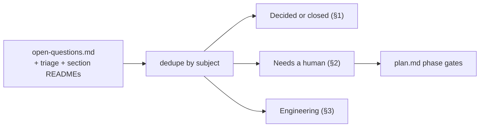

# Open Questions: Deduplicated Summary

**Written by:** Z (assembly), 2026-10-24. **Source:** [open-questions.md](open-questions.md) (unchanged,
append-only), the open-question tables in each section README, [triage.md](../90-reviews/triage.md),
[FROZEN.md](../00-contracts/FROZEN.md) adjudications and the CCR rulings in
[contract-change-requests.md](contract-change-requests.md).

## Purpose

Collapse duplicates, record what has already been decided, give every open question a recommendation, and flag
the questions that need a human decision. A question counts as needing a human (**H**) when the owner named in the
source is product, legal, compliance, security leadership, a budget or platform owner outside the Replicant team, or
"the user". Engineering questions that the owning workstream or the benchmarks can settle are marked **E**.

## Decisions summary

| | Count |
|---|---|
| Source entries in the coordination file (89 table rows, including updates and answers, plus 2 bullet updates) | 91 |
| Distinct question IDs (coordination file plus OQ-ORCH-01 from triage) | 82 |
| Distinct questions after merging duplicates | 78 |
| Already decided or closed (§1) | 29 |
| Open, needing a human (**H**, §2) | 35 |
| Open, engineering (**E**, §3) | 14 |

Section-only questions are listed in §4 and are not counted.

## 0. Duplicates merged

| Kept | Merged into it | Subject |
|---|---|---|
| OQ-00-09 | OQ-03-01 | Enterprise AI gateway capabilities |
| OQ-01-04 | OQ-05-01 | Default when the QA fix budget is exhausted |
| OQ-02-03 | OQ-03-02 | Challenge: D-12 (Kata memory requests) |
| OQ-11-04 | OQ-09-00, OQ-11-04 (decision) | Local dev seed token |
| OQ-09-04 | OQ-09-04 (answer) | Aurora vs RDS for `replicant` |
| OQ-11-05 | OQ-11-05 (answer) | KVM-capable CI runners |
| OQ-02-04 | OQ-02-04 (answer) | Spot capacity for sandbox pools |
| OQ-00-05 | WS-06 decision, OQ-09-03(b) response | Tightening-only tenant-derived bundles |
| OQ-05-04, -10, -17, -18 | their 17:45Z updates | QA builder privileges, QA re-run, readiness, service data |
| OQ-05-20 | the second OQ-05-19 (17:45Z) | Partition RLS gap (renumbered, R1V-124) |
| OQ-01-06 | triage "maximum job lifetime 60 days pending user confirmation" | Hard job lifetime |

## 1. Decided or closed

| ID | Question | Decision | Where recorded |
|---|---|---|---|
| OQ-00-01 | Accept Challenge: D-07 | Accepted; D-07 amended | FROZEN.md adjudications |
| OQ-00-02 | Separate exec EKS cluster | Accepted; strengthened to a separate AWS account | FROZEN.md; 09-security ADR-09-001, CCR-09-07 |
| OQ-00-03 | One job through PR review and repair | Adopted | 00-contracts ADR-009 |
| OQ-00-04 | `repo-mirror` as read-only token holder behind the broker | Accepted | FROZEN.md; ADR-011 as amended by CCR-09-06 |
| OQ-00-05 | Tightening-only tenant-derived bundles auto-promote | Yes, as eval tier T0; behavioral layers need T1 and two-person sign-off | 06-releases-and-evals ADR-06-001 |
| OQ-00-06 | Codex reviewer on `exec` or app-server | `codex exec --json`; app-server only for evaluation | 03-agents-and-tools ADR-03-003 |
| OQ-00-07 | Temporal self-hosted vs Cloud | Self-hosted 1.32.1 on PostgreSQL (Aurora, soak-gated) | 10-data-platform ADR-WS10-002 |
| OQ-00-08 | Temporal namespaces | One per environment | 01-orchestration ADR-01-005 |
| OQ-00-11 | Publisher ownership | WS-07 owns `publisher-worker`; WS-01 owns graph placement | C-ARCH; 07 README |
| OQ-01-01 | Accept Challenge: D-01 | Accepted | FROZEN.md |
| OQ-02-01 | Nested virtualization under Kata | Accepted with the metal fallback | 02-execution README |
| OQ-02-02 | `guestBlockDevice` mechanism | Accepted, gated by B-DISK tests | 02-execution README |
| OQ-02-03 | Challenge: D-12 | Accepted; D-12 amended (`match_limit` at p50 ≥ 0.8) | shared context D-12; ADR-03-008 |
| OQ-05-04 | `allowPrivilegeEscalation` for the QA builder | Allowed, Kata `qa_build` only | 02-execution controller.md §4.1 |
| OQ-05-10 | Re-running QA after an environment fix | Gate decision `rerun_qa` (CCR-05-04) | C-MSG 1.6.0 |
| OQ-05-17 | `startupProbe` for QA services | None; the harness owns readiness | XD-02-15 |
| OQ-05-18 | Where QA service data lives | `/workspace/.services/<name>` on the enforced workspace | XD-02-15 |
| OQ-05-20 | Partition RLS gap | `ops.secure_partition` plus hourly sweep | XD-ORCH-04 |
| OQ-06-01 | Ramp slots | `ramps[]` adopted (C-DEF 2.4.0) | 06 promotion.md §12 |
| OQ-07-04 | Default GitHub decision surface | Draft-PR check-run actions removed (R2-001); issue commands | 07 README |
| OQ-08-01 | Loki tenancy | By data class, with the enforced fixed-selector proxy; WS-09 aligned | 08 ADR-08-002; 09-security README decision 10 |
| OQ-09-03 | Two-person rule for tenant-scope memory and prod prompt/policy promotions | Yes, both | 04 README; 06 promotion.md §10 |
| OQ-09-04 | Aurora vs RDS for `replicant` | Aurora PostgreSQL 17 | ADR-WS10-001 |
| OQ-10-05 | Role-gated cross-tenant RLS vs GUC-only + BYPASSRLS | Role-gated, with the canonical scope rule | C-PG rule 4; 10 schema-management.md |
| OQ-11-01 | Accept Challenge: D-08 (MinIO locally) | Accepted: SeaweedFS default, MinIO from source as a profile (CCR-11-02) | 11 README; ADR-11-004 |
| OQ-11-02 | Langfuse in the `core` profile | Accepted | ADR-11-005 |
| OQ-11-03 | Identity link kind for Gitea users | `gitea` kind added (CCR-11-01) | C-MSG 1.1.0 |
| OQ-11-04 | Local-only dev seed token | Build-time exclusion with layered guards (WS-09 secrets.md §11); a runtime flag alone is rejected | 07 identity.md §9.3 |
| OQ-11-05 | KVM-capable CI runners | ARC on nested-virt `c8id`/`m8id` in the CI account; metal fallback | WS-10 answer |

## 2. Open: needs a human decision

Ordered by when the plan needs the answer ([plan.md](../99-implementation-plan/plan.md), "Open questions").
**Top 10** are marked ▲.

| | ID | Question | Recommendation | Who decides | Needed by |
|---|---|---|---|---|---|
| ▲ | OQ-00-09 (+OQ-03-01) | Does the enterprise AI gateway provide per-run credentials, per-run and per-job budgets, attribution and usage export, and protocol pass-through? | Keep the replicant-owned shim in front (ADR-03-005). Remove it only if the owner confirms GW-1..17 natively, including dynamic budgets from an external JWT | Platform owner of the AI gateway (FROZEN.md: "for the user") | before P6 (spike S-4) |
| ▲ | OQ-01-06 | Hard job lifetime `job_max_age_days` | **60 days**: it exceeds a 30-day gate wait plus a 30-day PR wait. Escrow and image retention are sized to 67 days | Product (the user); accepted by the orchestrator pending confirmation | before P7 |
| ▲ | OQ-ORCH-01 | Publish from forks instead of same-repo `replicant/**` branches, so target CI never runs agent code with secrets before review (R2-001) | Keep same-repo branches in v1 with the non-removable `critical` `ci_executed_paths` class and the onboarding requirement to keep secrets-bearing CI off `replicant/**` and `replicant-takeover/**`. Offer fork publishing per tenant when gate volume is high | The user | before P7 |
| ▲ | OQ-01-04 (+OQ-05-01) | QA still failing after the fix budget: fail the job, or open the publish gate for a draft PR? | **`fail_job` default** (WS-01). WS-05 preferred a draft-PR gate, but a draft PR already runs target CI (R2-001), so the safer default wins. Tenants may opt in to `gate_with_failure` | Product | before P7 |
| ▲ | OQ-04-01 | May repo- and path-scoped memory rules auto-activate after merge under policy, with 14-day probation and 20 % holdout? | Yes, but **only from P8**, after P5/P7 memory evals show benefit. Until then every activation is admin-approved. D-25 is satisfied by admin-configured policy | Product (orchestrator) | before P8 |
| ▲ | OQ-06-05 | Annual eval budget: $0.65M–$1.13M projected; policy ceiling $1.2M per year ($28k/week, $100k/month) | Fund the ceiling for two quarters, then re-decide on measured cost per case | Engineering leadership | before P7 |
| ▲ | OQ-09-01 | Which tenants are `restricted` (isolation groups, opaque slugs, mandatory publish gate)? | Classification-driven: payments core, identity, security tooling at launch. Onboard them only in P8 when isolation groups are proven | Security leadership, tenant owners | before P7 |
| ▲ | OQ-10-01 | Regional disaster RTO 4 h (RPO ≤ 1 min databases, ≤ 15 min artifacts) | 4 h, warm data and pilot-light compute (≈ +$0.7k/month), consistent with 99.9 % | Product | before P6 |
| ▲ | OQ-06-04 | Consent for using tenant repository content in the shared golden set | Per-tenant opt-in once; withdrawal erases that tenant's tasks; `restricted` data never used | Product, WS-09, legal | before P7 |
| ▲ | OQ-07-05 | GitHub identity linkage source | GHEC SAML external identities where available (zero-click), OAuth link otherwise | Enterprise GitHub owners | before P4 exit |
| | OQ-01-07 | How long a job may hold on a dependency outage before failing | 72 h, so a weekend outage is survived | Product, WS-10 | before P7 |
| | OQ-01-03 | Auto-consent migrations between bundles that differ only by tightening configuration | No: always ask (CC-3). Revisit with migration acceptance data | Product, WS-06 | before P2 exit |
| | OQ-01-05 | Hotfix repair pushes need publish approval every cycle? | Always; hotfix repair budget 2 cycles | WS-07, product | before P3 exit |
| | OQ-03-03 | Default treatment of a target repo's own `CLAUDE.md` / `AGENTS.md` | Quote as untrusted context (ADR-03-007) | Product, WS-04 | before P3 exit |
| | OQ-03-04 | Provider zero-data-retention per model and per-tenant data-classification ceilings | Both: `zdr` flag per model and `dataClassificationCeiling` in budgets | WS-09 with legal | before P7 |
| | OQ-03-05 | Source of truth for model prices | Enterprise export when present, otherwise the contract sheet via admin API; nightly reconciliation | FinOps | before P7 |
| | OQ-04-02 | Memory holdouts: 2 % of jobs with no pushed memory, 20 % of eligible jobs withhold probation entries | 2 % and 20 %; the only unbiased measurements | Product | before P5 exit |
| | OQ-04-03 | Show non-admins who wrote the source comment of a memory entry? | Hide | Product, WS-07 | before P5 exit |
| | OQ-04-04 | Preferences at team scope only, never per person? | Team scope only (ADR-04-005) | Product | before P5 exit |
| | OQ-04-05 | Embedding provider through the gateway | `voyage-code-4` at 1,024 dims, swappable per embedding space | Platform owner, WS-03 | before P5 |
| | OQ-05-08 | Should visual diffs block for UI-owning tenants? | Advisory in v1 | Tenant owners | before P7 |
| | OQ-05-11 | Should `flaky_new` tests block? | Block by default, tenant-overridable | Tenant owners | before P7 |
| | OQ-06-08 | Minimum 72 h canary for prompt-only changes | Keep 72 h; 24 h halves detection power | Product, release managers | before P7 |
| | OQ-06-09 | Early release ring tenants | Volunteers carrying 10–20 % of traffic, at least one per major codebase type | Tenant admins, release managers | before P7 |
| | OQ-06-13 | Holdback length for model changes | 30 days | Release managers | before P7 |
| | OQ-07-02 | Slack one-click approval for `critical` gates | No: UI only ("Review in Replicant") | WS-09, product | before P4 exit |
| | OQ-07-03 | Two-person rule (quorum) for critical job gates | Single winner in v1; GitHub required reviews are the independent second person | Product, orchestrator | before P4 exit |
| | OQ-07-06 | Requester deprovisioned while a job runs | Pause and notify tenant admins | Product | before P4 exit |
| | OQ-08-02 | License Langfuse Enterprise | OSS for v1; revisit if engineers need direct Langfuse access | Budget owner, WS-09 | before P6 |
| | OQ-08-10 | SLO-1 (first progress ≤ 60 s) objective | 99 %, revisit after 30 days of data | Product | before P7 |
| | OQ-08-11 | Workflow history export retention | 2 years default, 7 years by tenant policy | WS-09, compliance | before P6 |
| | OQ-09-05 | Live verification of secrets found in code | Opt-in per tenant, from a core service only | Security leadership | before P7 |
| | OQ-09-06 | SOC 2 categories in scope | Security + Confidentiality | Compliance owner | before P7 |
| | OQ-10-02 | Backup-account Vault Lock mode | Governance: compliance mode would block erasure of PII inside backups for the whole lock period | WS-09, legal | before P6 |
| | OQ-10-03 | Tenant offboarding export window before crypto-shred | 30 days, extendable per tenant | Product, legal | before P7 |

## 3. Open: engineering (owner decides, no human escalation needed)

| ID | Question | Recommendation | Owner |
|---|---|---|---|
| OQ-00-10 | Keep any raw (unredacted) transcripts? | Never. Only `cli_session_state` is raw (restricted bucket, job + 7 days) | WS-08, WS-09 |
| OQ-01-02 | Closed-workflow retention in the Temporal namespace | 30 days; long-term record is projections, audit, approval records and the history export | WS-10 |
| OQ-02-04 | Spot capacity for sandbox pools | On-demand only in v1. WS-10 has no objection to spot for `utility` later | WS-02, WS-10 |
| OQ-02-05 | Residual token validity after a run ends (≤ 60 min, one audience) | Accept, plus the grant revocation list and the exec revocation feed (R-09 accepted in known-issues §5) | WS-09 |
| OQ-02-06 | Auto-cancel runs with repeated denied egress | Alert only in v1; revisit with false-positive data | WS-09 |
| OQ-04-06 | Safety-class quarantines auto-cancel affected running jobs? | Notify plus one-click cancel | WS-09, orchestrator |
| OQ-05-19 | Testcontainers (rootless Podman Docker API) later | Not in v1; revisit once WS-02 proves a `/dev/net/tun` path without `privileged` | WS-09, WS-05 |
| OQ-06-11 | Guardrail rollbacks act on derived data (projections, Prometheus) | Accept: the action is fail-safe; promotion still needs system-of-record evidence | Orchestrator |
| OQ-07-01 | Live Okta group read on every gate decision | Yes, with replica fallback only if fresh (< 5 min) and risk < critical; otherwise deny `identity_unverifiable`. Spike S-10 measures it | WS-09, identity owners |
| OQ-08-03 | Tempo HA from day one | Monolithic until 50 GB/day or SLO relevance | WS-08, WS-10 |
| OQ-08-06 | LeakPurge holds the leaked value KMS-sealed for its lifetime | Yes, sealed and deleted at close, never in history in clear | WS-09 |
| OQ-08-07 | Delete Temporal history of a closed job after a purge | Keep until retention; delete for restricted tenants on request | WS-09, WS-01 |
| OQ-09-02 | Residual R-04: compromised runner-api can vend STS sessions for any tenant's run prefixes | Accept with detection (CloudTrail data events vs active runs) for v1; revisit after the first red team (accepted in known-issues §5) | Orchestrator, WS-02, WS-09 |
| OQ-10-04 | Temporal on Aurora PostgreSQL 16 | Aurora, gated by the staging soak (spike S-5), RDS for PostgreSQL 16 as the fallback | WS-10, WS-01 |

(OQ-02-05 and OQ-09-02 are recorded as accepted risks in [known-issues.md §5](../90-reviews/known-issues.md); they
stay here because the source entries ask for a revisit.)

## 4. Raised only in section READMEs

These are not in the coordination file. All are engineering questions with a recommendation from the owner.

| Source | Question | Recommendation |
|---|---|---|
| 02-execution README | Per-pod dm-crypt for regulated tenants on top of Nitro instance-store encryption | Only if Nitro encryption cannot be confirmed for M8id/R8id |
| 02-execution README | `503 cluster_capacity` at createRun | Not at admission; cluster waits come from AgentRun status (XD-W2-02-04) |
| 02-execution lifecycle-and-failures.md | Node-loss threshold 60 s vs 300 s | 60 s |
| 05-qa README | Mixed fleet (gVisor coding, Kata QA) if gVisor wins for coding (OQ-05-16) | Yes |
| 05-qa README | Stub contract revision default (OQ-05-05) | `deployed_prod`; both for `api_change` |
| 06-releases-and-evals README | Gateway batch path and record mode for `replicant-eval` (OQ-06-06) | Metering required; batch and record optional |
| 08-observability README | Langfuse trace-name resolution with early `unrouted` spans (OQ-08-04) | Verify in load test (spike S-8) |
| 11-local-dev README | `stub` selector in the shim's run policy | Policy field, rejected by production shims |
| 11-local-dev README | `replicant dev up` defaults to `replay` with no dev keys | Yes |

## Open questions

None beyond those listed.

## Risks

Several **H** questions have defaults already built into the spec (60-day lifetime, `fail_job`, same-repo
publishing). If the human decision differs, the change is configuration (`repair_limits`, `gate_rules`, onboarding
policy), not code, except fork publishing, which needs Publisher and github-integration work in P4.

## Interfaces consumed / provided

- **Consumed:** [open-questions.md](open-questions.md), section READMEs, [triage.md](../90-reviews/triage.md).
- **Provided:** the decision list for the user and the phase gates in [plan.md](../99-implementation-plan/plan.md).
